# Post-contenido — Unidad 8: Persistencia con JPA/Hibernate

## Información del Estudiante
* **Nombre:** Andrea Valentina Rivera Fernández
* **Código:** 1152444
* **Institución:** Universidad Francisco de Paula Santander (UFPS)
* **Carrera:** Ingeniería de Sistemas
* **Materia:** Programación Web
* **Unidad:** 8
* **Año:** 2026

## Descripción

Repositorio del laboratorio de la Unidad 8 de Programación Web. Contiene un
único proyecto Maven Spring Boot (`catalogo-jpa/`) con un CRUD de categorías
usando Spring Data JPA e Hibernate contra MySQL, y su extensión con la
entidad `Producto` y una relación `@ManyToOne`/`@OneToMany` hacia `Categoria`.

**Tecnologías:** Java 17, Spring Boot 4, Spring Web, Spring Data JPA,
Hibernate, MySQL 8, Thymeleaf y Bean Validation.

## Funcionalidades implementadas

- CRUD completo de categorías: listar, crear, editar y eliminar con pantalla
  de confirmación.
- Validación con Bean Validation (`@NotBlank`, `@Size`, `@Positive`, `@Min`),
  con mensajes junto a cada campo y sin perder los datos del formulario.
- Nombre de categoría único, con mensaje legible antes de llegar a la base.
- CRUD de productos asociados a una categoría.
- Lista de productos con el nombre de su categoría (`JOIN FETCH`).
- Consulta JPQL personalizada: productos de una categoría con precio mayor a
  un valor dado, ordenados de mayor a menor precio.
- Rechazo del borrado de una categoría que tiene productos asociados.

## Parte 1 — CRUD de Categoría con JPA/Hibernate y MySQL

`CategoriaController`, `CategoriaService` y `CategoriaRepository`
(`JpaRepository`) gestionan la entidad `Categoria`, persistida en MySQL
mediante Hibernate. El servicio usa `@Transactional` y verifica el nombre
único antes de guardar. Las plantillas Thymeleaf son `lista.html`,
`formulario.html` y `confirmar-eliminar.html`.

## Parte 2 — Relación @ManyToOne/@OneToMany con Producto

La entidad `Producto` es el lado propietario (columna `categoria_id`,
`FetchType.LAZY` explícito) y `Categoria` el lado inverso (`mappedBy`).
`ProductoRepository` expone `buscarPorCategoriaConPrecioMayorA`, una consulta
JPQL con `@Query` y `JOIN FETCH` que devuelve los productos de una categoría
con precio mayor a un valor en una sola sentencia SQL.

## Diagrama de la relación

```
+------------------+         1       N        +--------------------+
|    Categoria     |------------------------->|      Producto      |
+------------------+  @OneToMany(mappedBy)    +--------------------+
| id (PK)          |                          | id (PK)            |
| nombre (unique)  |<-------------------------| nombre             |
| descripcion      |  @ManyToOne(LAZY)        | precio             |
+------------------+  @JoinColumn             | stock              |
                                              | categoria_id (FK)  |
                                              +--------------------+
```

## Endpoints

| Método | URL | Descripción |
|---|---|---|
| GET | `/categorias` | Lista de categorías |
| GET/POST | `/categorias/nuevo`, `/categorias/guardar` | Crear |
| GET | `/categorias/editar/{id}` | Editar |
| GET/POST | `/categorias/eliminar/{id}` | Confirmar y eliminar |
| GET | `/productos` | Lista de productos con su categoría |
| GET/POST | `/productos/nuevo`, `/productos/guardar` | Crear o editar |
| GET | `/productos/editar/{id}` | Editar |
| POST | `/productos/eliminar/{id}` | Eliminar |
| GET | `/productos/categoria/{id}/precio-mayor?minimo=X` | Consulta JPQL filtrada |

## Decisiones de diseño

- **`ddl-auto=update` en lugar de `create`.** Conserva los datos de prueba
  entre reinicios y permite agregar la tabla `productos` en la Parte 2 sin
  borrar lo ya guardado. En producción se usaría `validate` o `none`.
- **Nombre único en `Categoria`.** Además de `unique = true` en la columna,
  `CategoriaService` lo verifica antes de guardar y el controlador lo muestra
  junto al campo, en lugar de dejar que la base lance una excepción.
- **`FetchType.LAZY` explícito en `Producto.categoria`.** JPA carga
  `@ManyToOne` en EAGER por defecto. Con LAZY no se trae la categoría en cada
  acceso a un producto; donde sí se necesita el nombre se usa `JOIN FETCH`
  en el repositorio, lo que además evita el problema N+1.
- **Sin `cascade = REMOVE` de `Categoria` hacia `Producto`.** Un clic
  accidental no debe borrar en silencio todos los productos. El servicio
  rechaza el borrado si la categoría tiene productos y explica por qué.
- **Método helper `asignarCategoria` en `Producto`.** Mantiene sincronizados
  los dos lados de la relación bidireccional, en vez de repetir esa lógica
  en el servicio.
- **POST para eliminar productos.** Una petición GET no debe modificar datos.
- **Sin dialecto explícito de Hibernate.** Hibernate detecta MySQL solo; la
  propiedad `MySQL8Dialect` está obsoleta en las versiones nuevas.
- **`allowPublicKeyRetrieval=true` en la URL JDBC.** Necesario para que
  MySQL 8 con `caching_sha2_password` acepte la conexión en desarrollo.

## Prerrequisitos

- JDK 17 o superior
- MySQL 8.x en ejecución
- Maven (se usa el wrapper `mvnw` incluido)
- IntelliJ IDEA, Git y un navegador

## Configuración de la base de datos

1. Entrar a MySQL: `mysql -u root -p`
2. Crear la base de datos y el usuario:
   ```sql
   CREATE DATABASE catalogo_db CHARACTER SET utf8mb4 COLLATE utf8mb4_unicode_ci;
   CREATE USER 'appuser'@'localhost' IDENTIFIED BY 'apppass';
   GRANT ALL PRIVILEGES ON catalogo_db.* TO 'appuser'@'localhost';
   FLUSH PRIVILEGES;
   ```
3. Comprobar `catalogo-jpa/src/main/resources/application.properties`: URL
   `jdbc:mysql://localhost:3306/catalogo_db`, usuario `appuser` y clave
   `apppass`. Hibernate crea las tablas al arrancar (`ddl-auto=update`).

## Cómo compilar y ejecutar

1. Clonar el repositorio:
   ```
   git clone https://github.com/Andrea-Rivera31/rivera-post1-u8.git
   ```
2. Crear la base de datos (ver arriba) y comprobar que MySQL esté corriendo.
3. Entrar al proyecto y ejecutar:
   ```
   cd rivera-post1-u8/catalogo-jpa
   ./mvnw spring-boot:run
   ```
4. Parte 1: http://localhost:8080/categorias
5. Parte 2: http://localhost:8080/productos

Consulta filtrada de ejemplo:
http://localhost:8080/productos/categoria/1/precio-mayor?minimo=50000

## Capturas de pantalla

### Parte 1 — CRUD de Categoría

Arranque con la tabla creada por Hibernate:

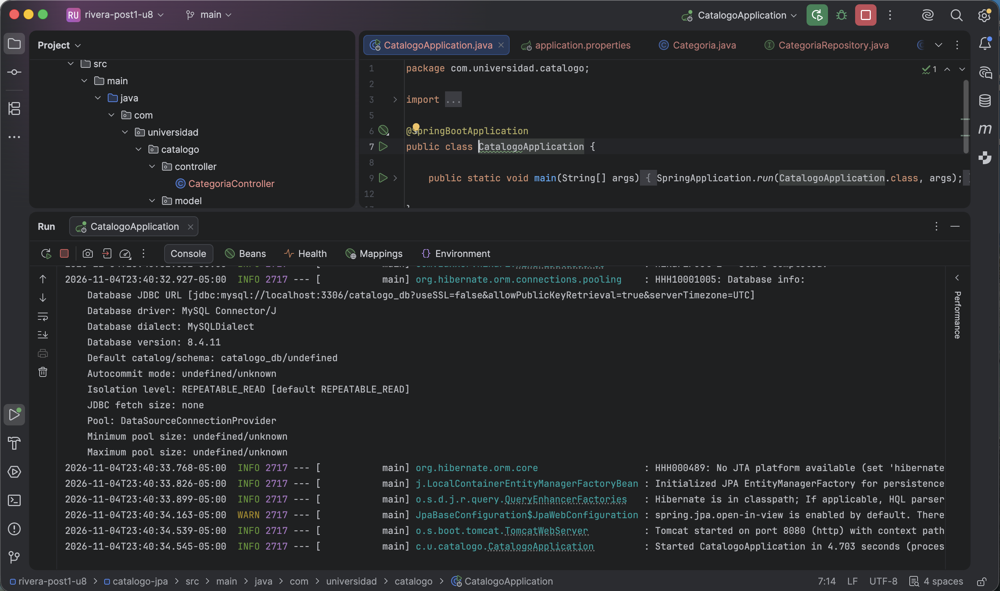

Tabla `categorias` en MySQL:

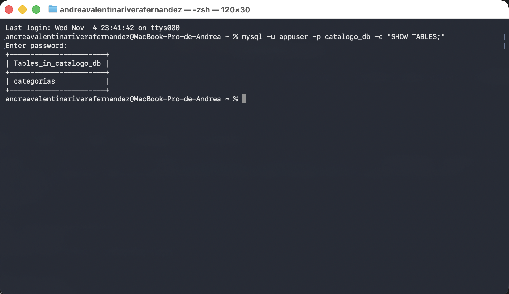

Lista de categorías:

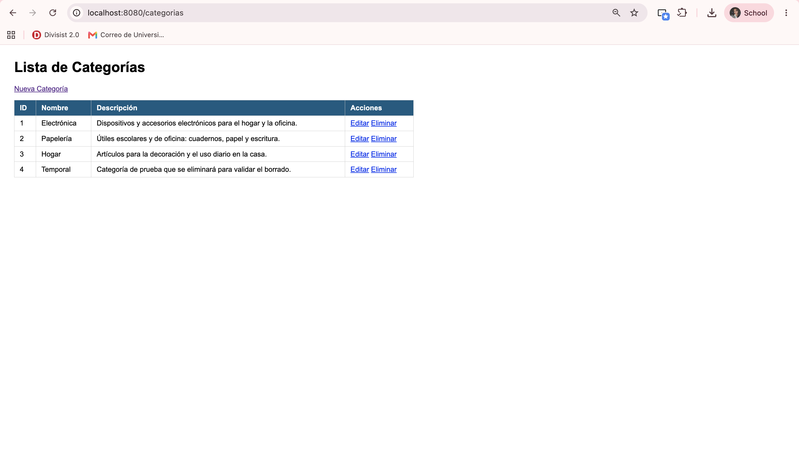

Registros persistidos en MySQL:

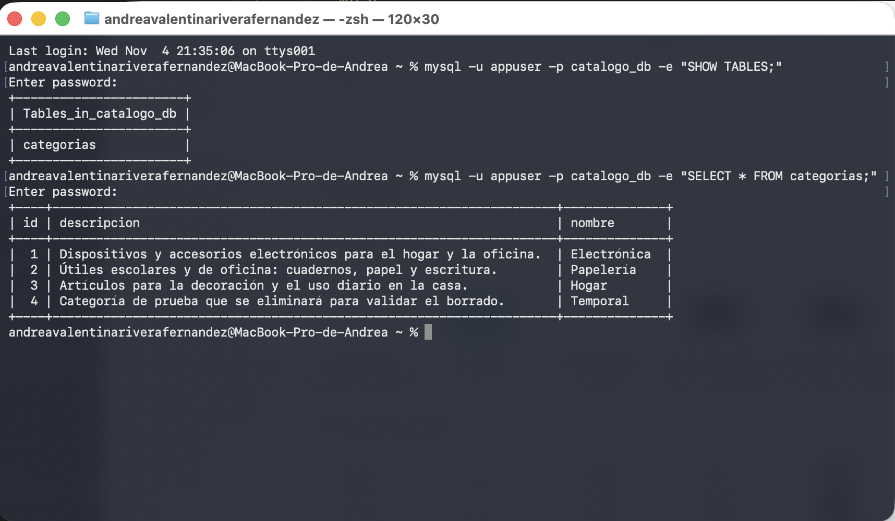

Validación del formulario:

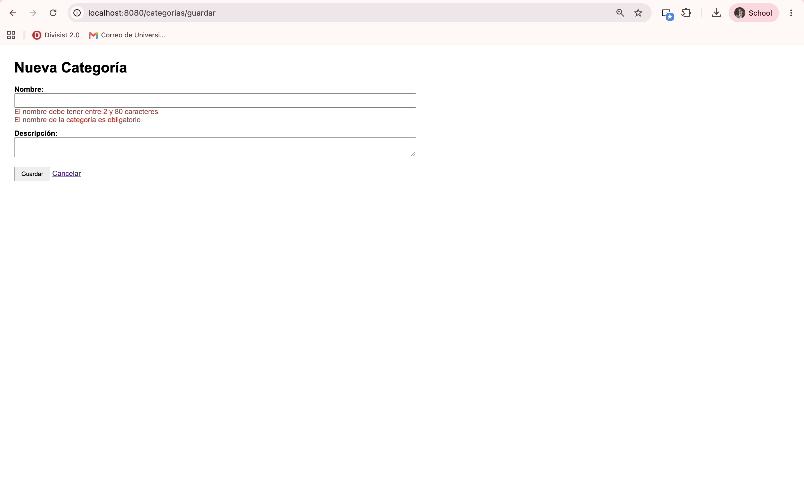

Nombre duplicado:

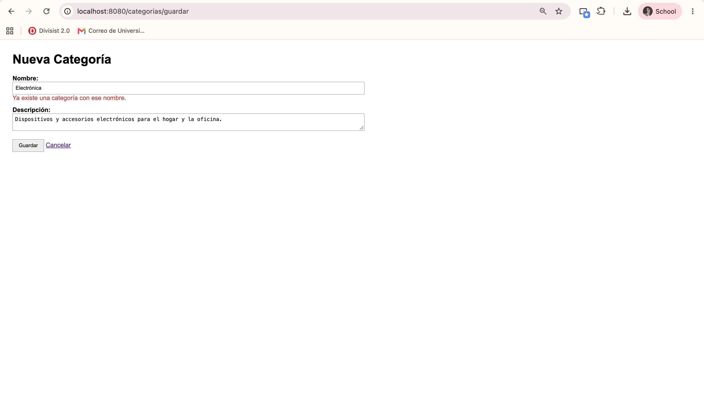

Edición:

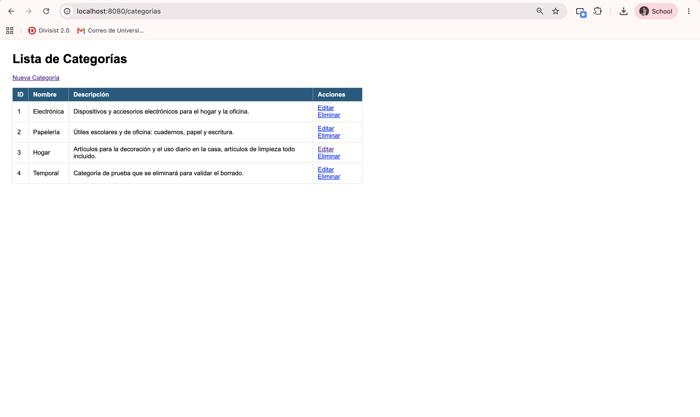

Confirmación de eliminación:

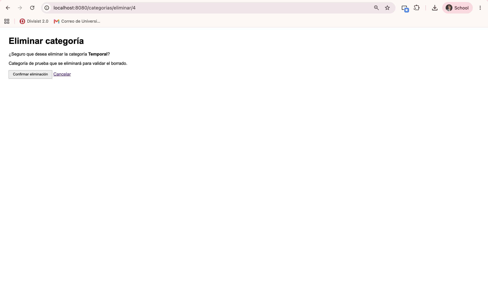

Historial de commits de la Parte 1:

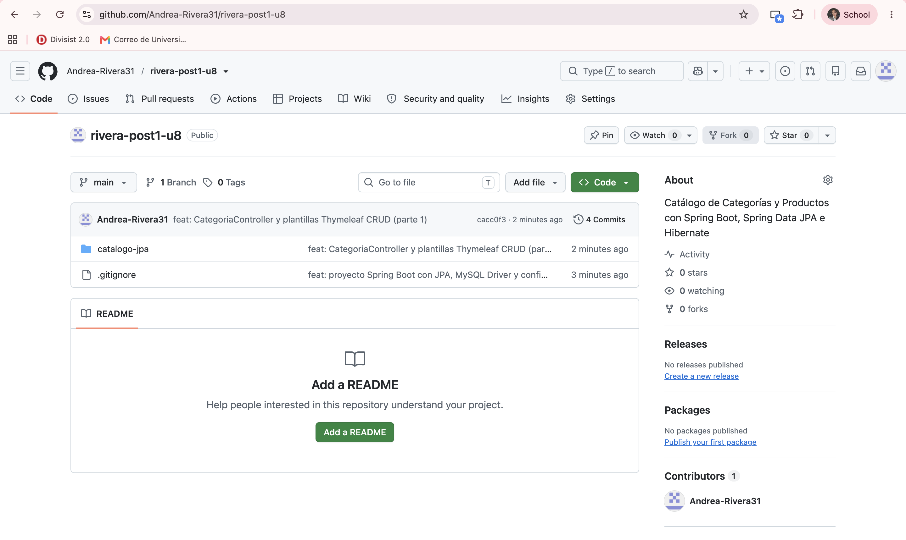

### Parte 2 — Producto y consulta JPQL

Tabla `productos` con `categoria_id` NOT NULL:

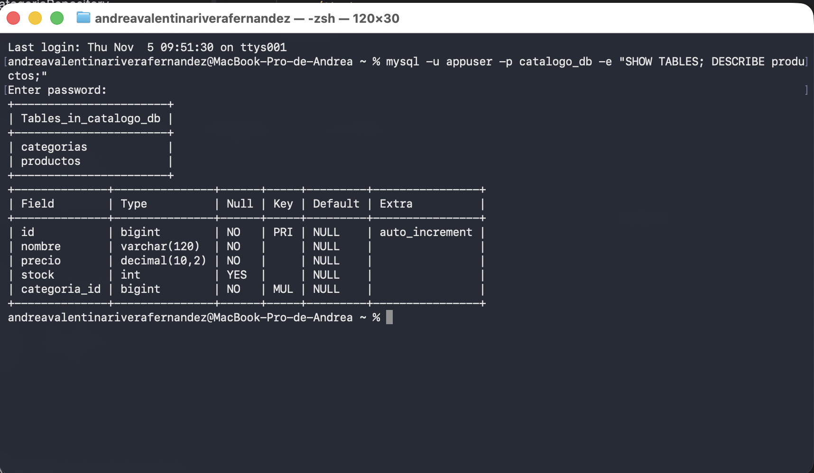

Validación del formulario de producto:

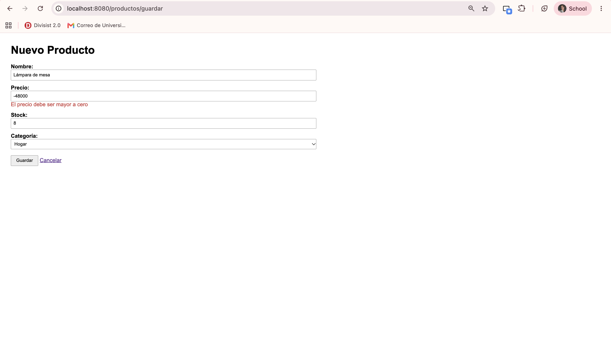

Lista de productos con su categoría:

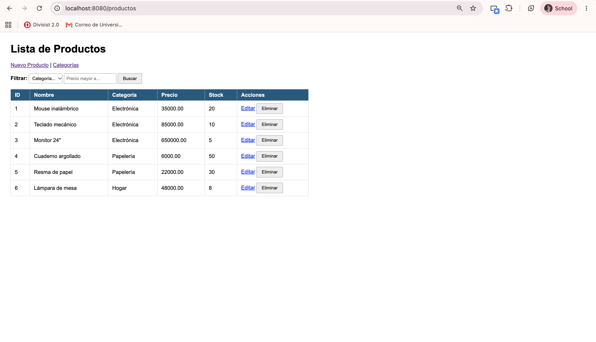

Productos persistidos en MySQL:

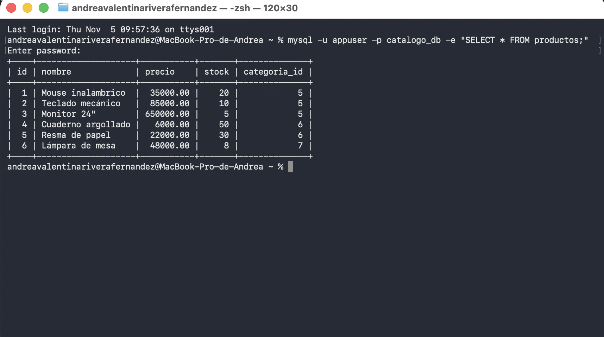

Edición de un producto:


Productos filtrados por categoría y precio:

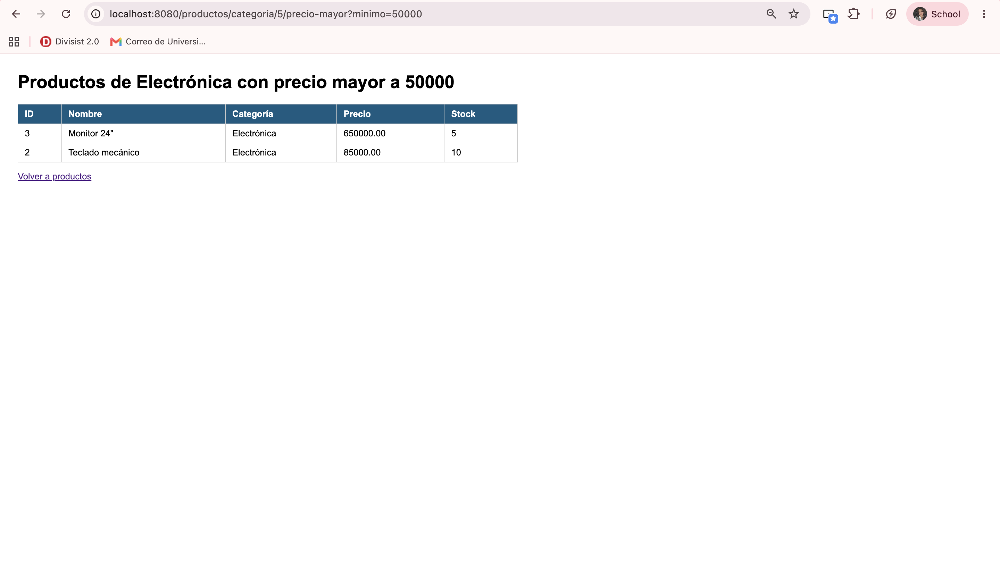

SQL con un único JOIN en la consola:

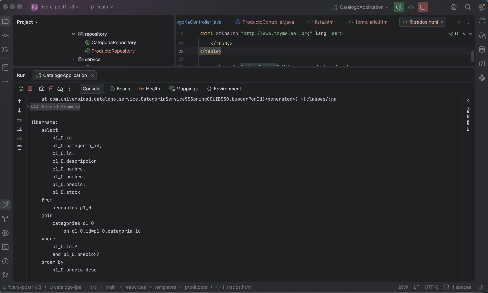

Borrado rechazado de una categoría con productos:

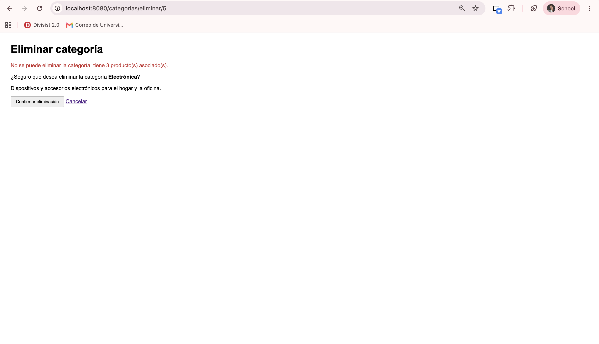